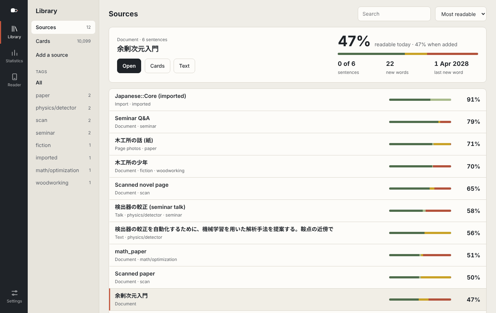
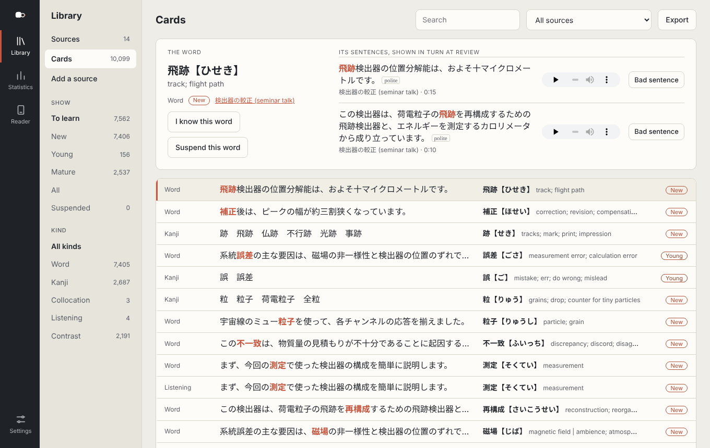
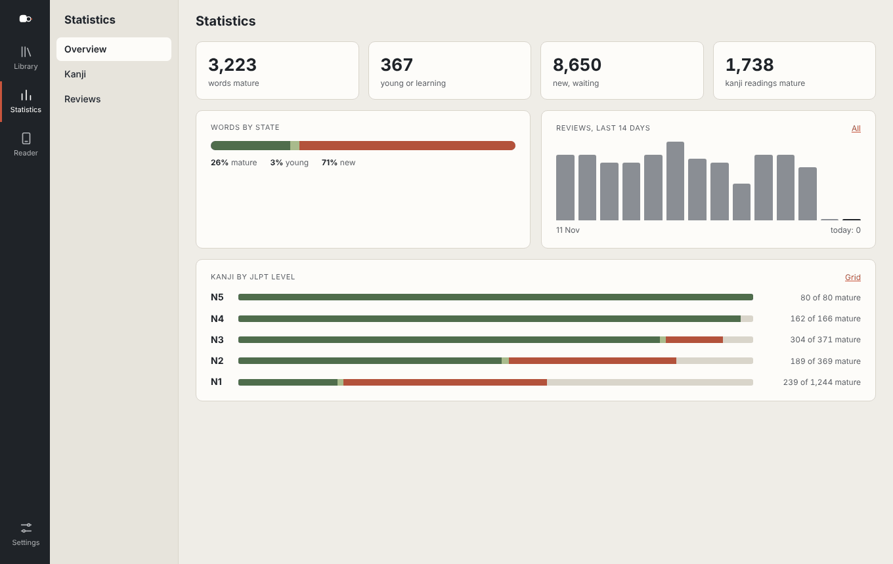

# Sumitsubo (墨壺)

Turn the Japanese you need to understand (talks, papers, books) into flashcards, and see how
readable each source is for you today.

You bring a seminar recording, a paper or a novel. Sumitsubo tells you how much of it you can read
now, makes the cards that close the gap, and the number moves as you study. The question it answers
is "can I read this yet?", not "how many cards did I do?".

<p align="center"></p>

It is for intermediate and advanced learners who have to work in Japanese, such as graduate
students and researchers. It is not a course, and not for beginners. If you enjoy tuning every
detail of your cards, Anki is the better tool.

> **Status: early, and built for one person's use so far.** Linux is where it runs daily; macOS
> should work; Windows is untried. Expect rough edges.

## What it does

- **One pipeline.** Paste a link or choose a file: a video, a PDF, an EPUB, subtitles with their
  recording, an Aozora Bunko book, photographs of printed pages. You get words, kanji readings,
  audio clips and a difficulty score, with nothing to assemble from separate tools.
- **Your own material, including academic text.** Field vocabulary, your own glossaries, scanned
  papers, recorded talks. Reference lists, captions and other debris are kept off the cards.
- **Five kinds of card, made for you.** Words in sentences from your sources, listening, kanji
  as a reading inside words you have met, collocations, and contrast cards for things you mix up.
- **A score per source.** The share of it you can expect to read today, the sentences you can read
  in full, and the date by which its last new word will have been introduced.
- **Not a silo.** Progress comes in from Anki and Renshuu with its history, and goes back out to
  Anki with memory states and review history. Everything runs on your own computer, with no account.
- **A reader device.** With [Sumitsubo Reader](https://github.com/Temigo/sumitsubo-reader) on a
  pocket e-ink reader, you review the cards there and read your books with what you know applied:
  how readable a book is, which words are new, which furigana you no longer need.

<p align="center">
  
  
</p>

## Install

Linux or macOS, Python 3.11 or newer, and git. ffmpeg is needed for audio and video sources.

```bash
sudo apt install ffmpeg git          # macOS: brew install ffmpeg git python
git clone https://github.com/Temigo/sumitsubo.git
cd sumitsubo
sh install.sh                        # add --no-paper to skip the reader for photographed pages (160 MB)
```

`install.sh` makes a private Python environment in `.venv`, installs the program into it, puts a
`sumitsubo` command in `~/.local/bin`, and downloads the dictionary data. Nothing is installed
system-wide and nothing needs sudo. Run it again after `git pull` to update; your data lives in
`~/.local/share/sumitsubo` and is not touched.

By hand, the same thing is `python3 -m venv .venv && . .venv/bin/activate && pip install -e . && sumitsubo setup`.

## Getting started

```bash
sumitsubo serve          # then open http://127.0.0.1:8378
```

1. **Settings, General:** say roughly what level you are at. Words at or below it are treated as
   already known and come back once, months later, as a check.
2. **Settings, Imports** (optional): bring in your Anki or Renshuu progress, so nothing starts
   from zero.
3. **Library, Add a source:** paste a link, choose a file, or paste text. "Check difficulty only"
   scores it without adding it.
4. **Library, Sources:** see how readable it is. **Cards** shows what was made.
5. **Review** on a [Sumitsubo Reader](https://github.com/Temigo/sumitsubo-reader) (Reader, Sync), or
   in Anki (Cards, Export).

Everything is also on the command line: `sumitsubo add paper.pdf`, `sumitsubo status`,
`sumitsubo sync`, `sumitsubo export-anki out.apkg --progress`.

There is no login. The program listens on this computer only, unless you start it with `--phone`
(to send page photos from a phone) or `--host 0.0.0.0`; do the latter only on a network you trust.

## More

The **[guide](docs/guide.md)** covers the cards and what each trains, how knowledge is modelled,
every kind of source, importing progress, the reader device, the way back to Anki, the command
line, how it works inside, and the known limits.

To run the tests: `pip install -e ".[test]" && pytest -q`.

## Licences and credits

Sumitsubo is licensed GPL-3.0-or-later, because it imports and ships with
[Anki Miner](https://github.com/0xzerolight/anki_miner) (GPL-3.0-or-later), pinned to commit
`fb8853b`. Dictionary data: JMdict and KANJIDIC2 (Electronic Dictionary Research and Development
Group, CC BY-SA 4.0), via jmdict-simplified; JLPT word lists by Jonathan Waller via yomitan-jlpt-vocab; JLPT kanji levels from his lists too
(tanos.co.uk), taken from the `kanji-lists` package (MIT) into `sumitsubo/data/jlpt_kanji.json`. No list of this kind is official: the JLPT has published none since 2010.
Word frequency data from [Jiten](https://jiten.moe) (CC BY-SA 4.0), downloaded once and kept as a local file.
Memory model: FSRS through [py-fsrs](https://github.com/open-spaced-repetition/py-fsrs) (MIT).
Look-alike kanji: the similar-kanji list by siikamiika (MIT), see `sumitsubo/data/README.md`.
The name is the carpenter's ink pot that snaps a straight line onto timber to show where to cut.
Page photos are read by [NDLOCR-Lite](https://github.com/ndl-lab/ndlocr-lite) (National Diet
Library, CC BY 4.0), pinned to commit `a25d456` (version 1.4.0). It is fetched by the user from the
library's repository and run as a separate program; it is not distributed with Sumitsubo. Its
layout model is additionally under the DINOv3 licence, which should be read before anyone
redistributes that model. Fallback readers: Tesseract (Apache-2.0) and OCRmyPDF (MPL-2.0).
